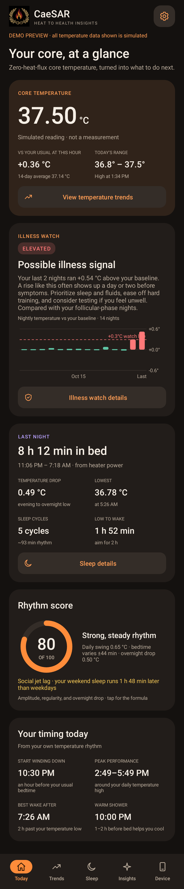
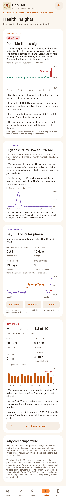
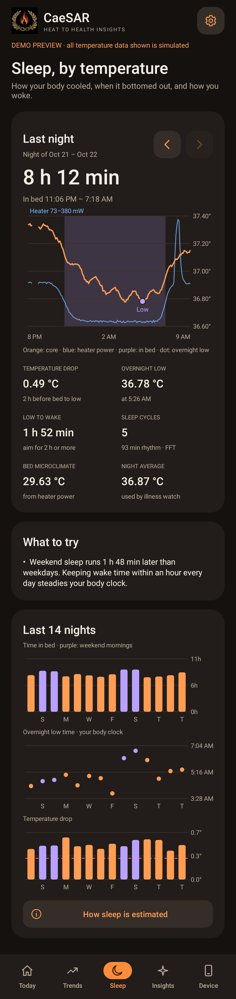

# CaeSAR Health for Android

Android 8.0+ app for the Forge Silicon Design CaeSAR wearable. It turns zero-heat-flux (ZHF) core temperature into actionable health data. No account, no Internet permission, no cloud backup. Same structure as the BEACON app: plain Java, no AndroidX, USB CDC ACM input, and a demo mode.

## Install

Download [`CaeSAR-debug.apk`](apk/CaeSAR-debug.apk) and open it on your phone. Allow installs from your browser or file manager when Android asks. Debug-signed **v1.0** test build. SHA-256 is in [`SHA256SUMS`](apk/SHA256SUMS). USB host is optional, so the app installs on any phone and the demo runs without hardware.

## Screens

| Today | Insights | Sleep |
| --- | --- | --- |
|  |  |  |

- **Today:** live core temperature, deviation from your usual at this hour, today's range, illness watch, last night, rhythm score, and personal timing windows.
- **Trends:** day, week, month, and 90-day temperature charts with low/high whiskers, sleep bands, and an optional heater-power overlay. Daily cosinor rhythm and environment estimates.
- **Sleep:** per-night temperature chart with the in-bed window and overnight low, drop, low-to-wake, sleep cycles, bed microclimate, tips, and 14-night charts.
- **Insights:** illness watch, body clock with an FFT rhythm spectrum, cycle insights, and heat strain.
- **Device:** connect, import the overnight buffer, try the demo, live ZHF loop readout (core, top sensor, heater, flux lock), and dev diagnostics.
- **Settings:** dark/light, °C/°F, cycle insights, log period start, heater calibration, delete data.

## What it computes

All of it runs on minute averages of core temperature and heater power.

| Insight | How | Why ZHF helps |
| --- | --- | --- |
| Temperature over time | Bucketed averages with low/high per bucket, gaps left blank | Core, not skin, so the trend is not the room |
| Sleep window | Heater power drops when bedding warms the air around the patch. Longest low-power stretch 6 PM to 2 PM, at least 3 h, bridging breaks up to 25 min. Core-threshold fallback | Novel: the ZHF heater doubles as an in-bed sensor |
| Temperature drop, overnight low | Evening 2 h mean minus the 30-min smoothed overnight minimum | Larger drop goes with consolidated sleep |
| Low to wake | Wake time minus the overnight low. Under ~2 h is linked to grogginess | Low is a circadian phase marker |
| Sleep cycles | Quadratic-detrended night, Hann window, 1024-pt FFT, strongest period in 60 to 130 min | Core ripples with the NREM/REM cycle. Same transform as the SoC FFT block. Experimental |
| Illness watch | Nightly mean vs median of nights 3 to 30 before. Flag at +0.3 °C and 2 robust SD. Two nights in a row = possible illness. Fever = 30 min at 38.0 °C, workouts excluded | Pre-symptom rises of a few tenths of a degree are hidden in skin temp |
| Cycle-aware baseline | With cycle insights on, nights are compared to nights in the same phase. Before enough luteal nights exist, a typical 0.3 °C luteal rise is discounted | Keeps ovulation from reading as a fever |
| Cycle insights (opt-in) | Three-over-six rule on nightly temps confirms ovulation. Predicts next period from luteal length. Flags short luteal phase and cycles with no shift | Core shows the biphasic shift cleanly. Not contraception |
| Body clock | 24 h cosinor over 72 h (mesor, amplitude, peak time), nightly low time and its 2-week drift, social jet lag from weekday vs weekend sleep midpoints | Tracks jet lag and schedule drift |
| Rhythm spectrum | 7 days, 10-min bins, 4096-pt FFT, shown on a log-period axis. Reports the share of variation at 20 to 28 h | Robust clock = sharp 24 h peak |
| Rhythm score | 40 × amplitude + 30 × bedtime regularity + 30 × overnight drop | Transparent, explained in-app |
| Timing windows | Wind-down 1 h before usual bedtime, peak performance ±1.5 h of daily high, wake 2 h past the low, warm shower 1 to 2 h before bed | Personal, moves with your rhythm |
| Heat strain | Fast climbs (≥0.1 °C/10 min, ≥0.5 °C rise, past 37.8 °C). Strain = thermal half of the PSI (Moran 1998), 0 to 10. Time above 38.5 and 39 °C, cool-down time, live minutes-to-39 °C | Core during exercise without a pill |
| Heat adaptation | Mean rise of the last 5 workouts vs the 5 before | Falling rise = acclimatizing |
| Environment | Air ≈ core − heater power × R_out (default 80 K/W from the Forge thermal model). Awake ambient, bed microclimate, cold and hot exposure | Novel: no extra sensor, the heater already measures heat loss |

These are experimental wellness insights, not diagnosis. Tests on synthetic data do not validate real-world accuracy.

## Demo mode

Device → **Try demo** loads nine weeks of synthetic data for a fictional wearer: later sleep on weekends, workouts Mon/Wed/Fri evenings and Saturday mornings with gradual heat adaptation, a weekday commute in the cold, two menstrual cycles, a fever five weeks ago, and an illness signal over the last two nights. It also streams a simulated 1 Hz live reading. Every screen shows a simulation banner. Demo data and demo period logs never touch the real database or settings. Stopping the demo restores real history.

## Firmware contract

USB CDC ACM, one JSON object per line (CRLF accepted):

```json
{"core":36.94,"top":36.91,"heater_mw":182.5,"lock":true,"t_ms":123456}
```

- `core` (required, 25 to 45 °C): deep-tissue estimate under the insulator.
- `top` (optional): sensor above the insulator.
- `heater_mw` (optional, 0 to 2000): heater power. Enables in-bed detection and environment estimates.
- `lock` (optional, default true): false while the loop is settling. Unlocked readings are shown but not saved.
- `t_ms` (optional): monotonic firmware milliseconds.
- `epoch` (optional, Unix seconds): marks a buffered history reading. Stored at that time.

**Import overnight data** sends `{"cmd":"sync"}`. Firmware should reply with buffered lines that carry `epoch`. Unknown fields are ignored. Invalid lines are counted as rejected.

## Storage

Readings are averaged per minute into local SQLite. Raw 1 Hz samples are not saved. Logged period starts are stored locally. Cloud backup and device transfer are disabled. Settings → Delete saved data removes history and period logs.

## Build and checks

JDK 17 and Android SDK Platform 35 / Build Tools 35.0.0. Gradle 8.9 and AGP 8.7.3 are pinned.

```sh
cd android
./gradlew :app:assembleDebug :app:testDebugUnitTest :app:lintDebug
adb install -r app/build/outputs/apk/debug/app-debug.apk
```

Tests cover demo analytics end to end (sleep windows, illness level and phase matching, both ovulations, body clock, social jet lag, heat episodes and adaptation, ultradian detection), fever vs workout separation, JSON parsing, the FFT, and Robolectric renders of every tab in both themes with a 44 dp touch-target check. Renders go to `app/build/visual-check/`.

Still untested: real USB hardware, real ZHF data, the firmware sync handler, and R_out calibration on the actual patch.
